<p align="center">
  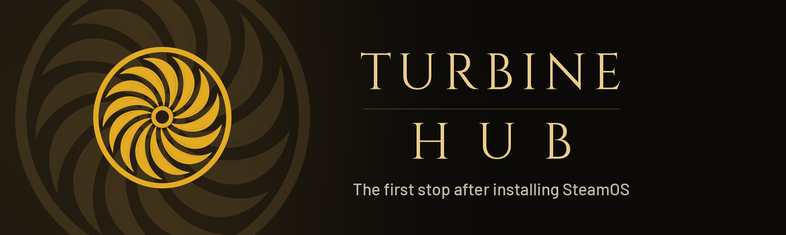
</p>

<p align="center">
  <a href="https://github.com/Ravenor907/TurbineHub/releases/latest"></a>
  
  
  
</p>

<p align="center"><b>The first stop after installing SteamOS.</b><br>
Set up a fresh SteamOS machine, check it, tune it and bring your Windows games and apps over, all with a controller.
Made for people coming from Windows, with a mode for people who already know their way around.</p>

<p align="center">
  <a href="#-install">Install</a> ·
  <a href="#-highlights">Highlights</a> ·
  <a href="#-screenshots">Screenshots</a> ·
  <a href="#-whats-inside">What's inside</a> ·
  <a href="#-controls">Controls</a> ·
  <a href="#-safe-by-design">Safe by design</a> ·
  <a href="#-faq">FAQ</a>
</p>

---

## ✨ Highlights

|   |   |
|---|---|
| 🧭 **Two ways in** | **Guided** walks a newcomer through four short steps in plain words. **Veteran** ("I know more than you.") is one screen of switches with the exact values |
| 🩺 **Home at a glance** | Battery, temperatures, power and fan, and a checkup that shows only what needs you, each with its fix |
| 🎮 **Games** | Will my games run? for your whole library, per-game switches instead of typing launch options (FSR 4 on Radeon RX 9000, frame generation, Proton log), Try another Proton with Undo, and help when a game won't start. Games with online anti-cheat are never touched |
| 🕰️ **Save time machine** | A snapshot of a game's saves every time it starts, restore in one press, and Undo. Saves from your Windows drive come along too |
| 📁 **Files** | A file explorer laid out like the one on Windows, in Game Mode too: This PC, C:, Users, Games, Program Files and the Recycle Bin over the real SteamOS folders, each game's own Windows C: drive one press away, and a True Linux view of the same disk. No password, ever |
| 🧩 **Store** | Hand-picked apps from Flathub, launchers through [NonSteamLaunchers](https://github.com/moraroy/NonSteamLaunchers-On-Steam-Deck), Decky Loader from its official release, TV and streaming tiles, emulation |
| 🪟 **Bring it over** | Copy Steam games from your Windows drive instead of downloading them again, and find the SteamOS version of the Windows apps you use. The Windows drive is only ever read |
| 🖥️ **My machine** | Power limit, Game Boost, screen and refresh range, battery charge limit, sleep and wake, graphics card power, drives, sound, dock and a system tune-up, shown only when your machine has them |
| 🌈 **Lighting** | Animated effects and presets (RGB Spiral, Neon Vortex, Aurora and more) with a live preview, battery and per-game colors, and Test lights. Works with any RGB lights SteamOS exposes, including the ROG Ally rings |
| ❓ **Where's my...?** | Task Manager, the C: drive, installing programs: where the things you knew from Windows are on SteamOS, plus a glossary of every word the app uses |
| ↩️ **Undo everything** | Every change is shown before it's made and listed afterwards, each with Undo, and Undo all puts the machine back |

## 🚀 Install

1. **Switch to Desktop Mode.** Press the **Steam** button, go to **Power**, then **Switch to Desktop**.
2. **Download** [`TurbineHub.flatpak`](https://github.com/Ravenor907/TurbineHub/releases/latest/download/TurbineHub.flatpak) from the [latest release](https://github.com/Ravenor907/TurbineHub/releases/latest).
3. **Open it.** Discover installs it. Or in Konsole:
   ```bash
   flatpak install --user ~/Downloads/TurbineHub.flatpak
   ```
4. **Open Turbine Hub** from the app launcher. The first start asks how you want to begin, and can add Turbine
   Hub to your Game Mode library with its own art.

Each release lists the SHA-256 of every file, so you can check what you downloaded:
`sha256sum ~/Downloads/TurbineHub.flatpak`.

Turbine Hub tells you on Home when a newer version is out (Settings, Updates).

## 📸 Screenshots

<table>
  <tr>
    <td width="50%">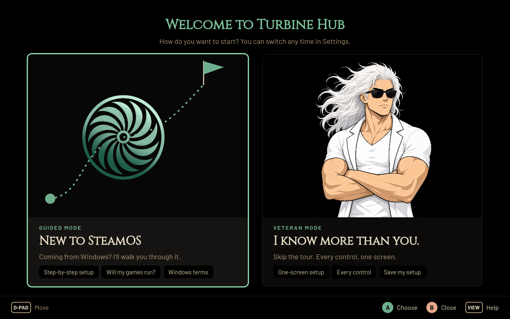<br><sub>First start: Guided or Veteran</sub></td>
    <td width="50%">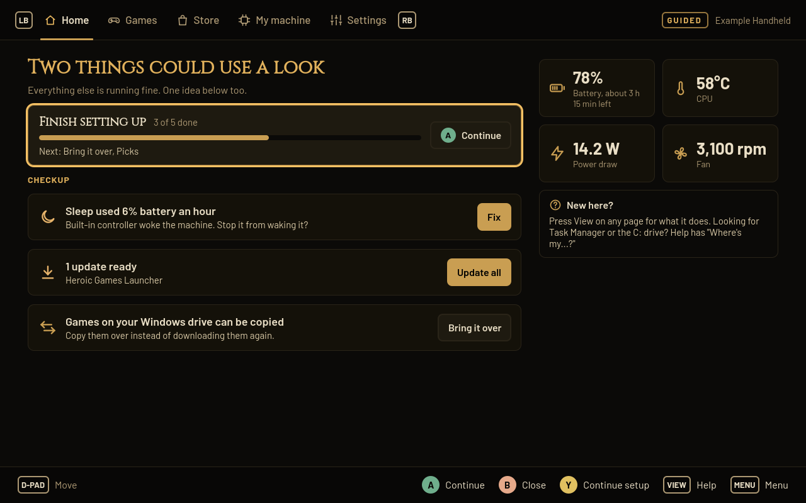<br><sub>Home: readings and a checkup with fixes</sub></td>
  </tr>
  <tr>
    <td>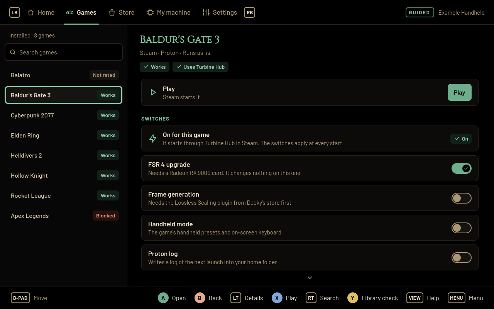<br><sub>Games: Play, switches and help per game</sub></td>
    <td>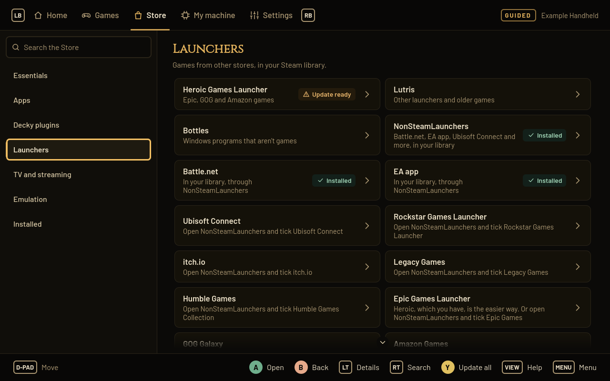<br><sub>Store: launchers through NonSteamLaunchers</sub></td>
  </tr>
  <tr>
    <td>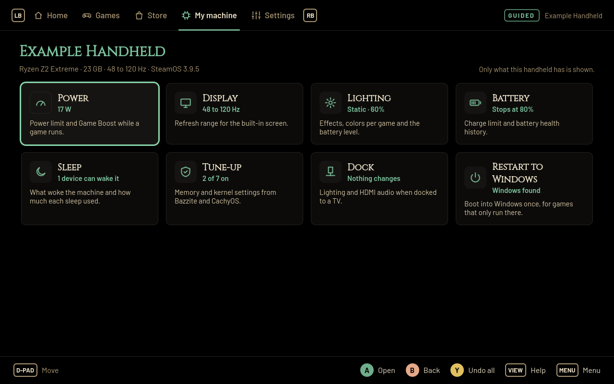<br><sub>My machine: only what this handheld has</sub></td>
    <td>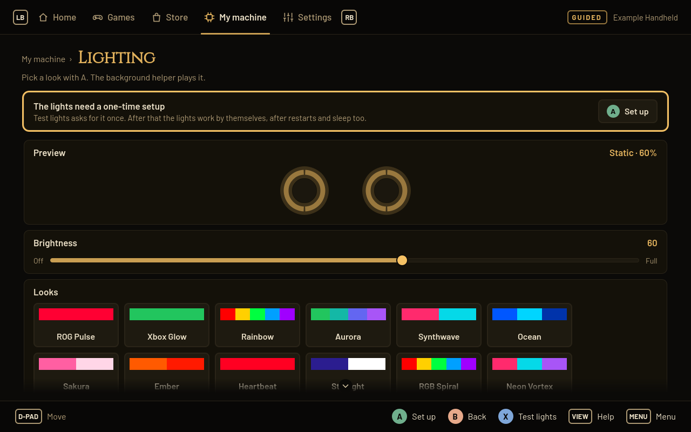<br><sub>Lighting: live preview and presets</sub></td>
  </tr>
  <tr>
    <td>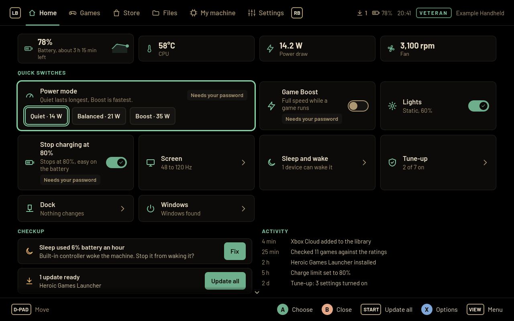<br><sub>Veteran Home: quick switches and activity</sub></td>
    <td>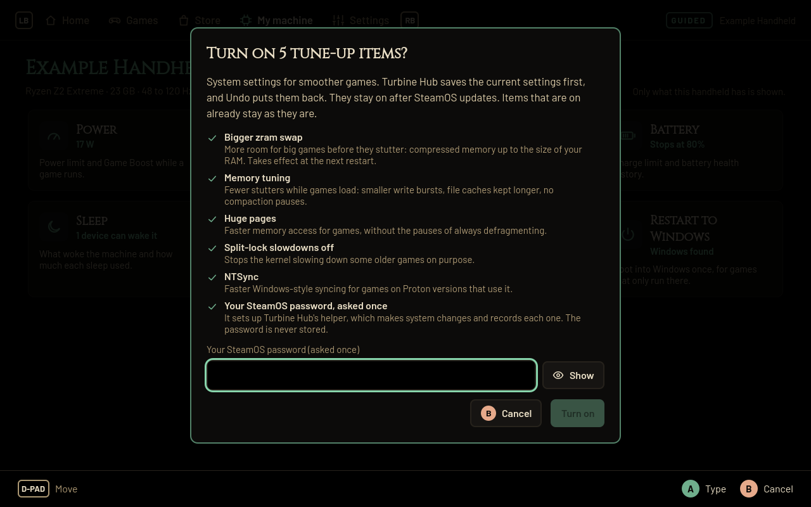<br><sub>Every change is shown first, then can be undone</sub></td>
  </tr>
  <tr>
    <td>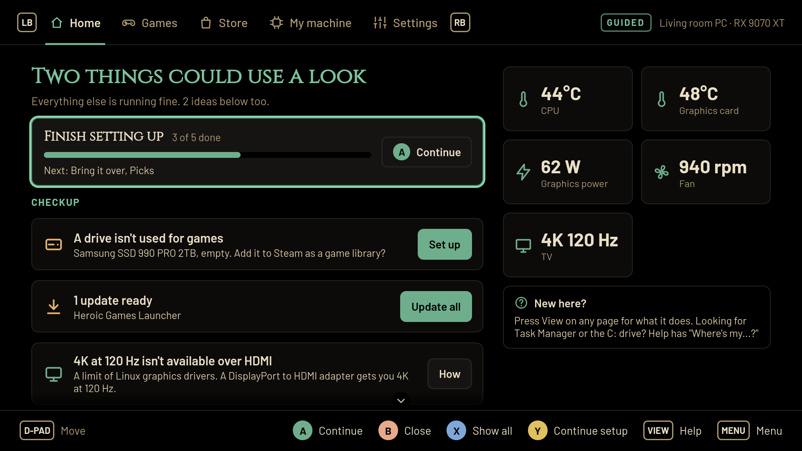<br><sub>A living room PC on a 4K TV</sub></td>
    <td>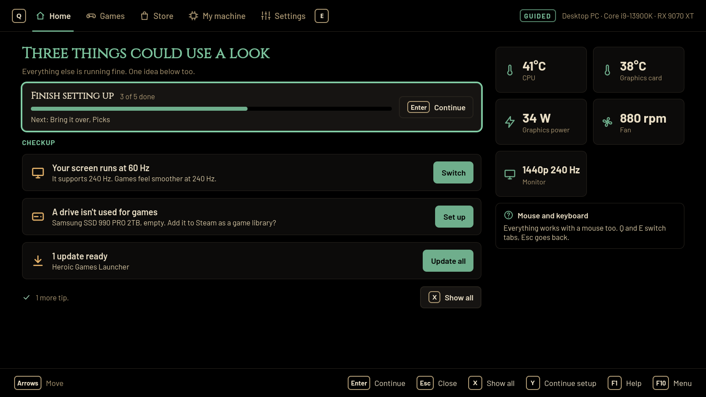<br><sub>A desktop PC, in a Desktop Mode window</sub></td>
  </tr>
</table>

## 🧭 What's inside

| Tab | What you find there |
|---|---|
| **Home** | Readings, the checkup with a fix for each item, Finish setting up, updates. Veteran adds quick switches and recent activity |
| **Games** | Every Steam and Heroic game with how well it runs here, Play, switches, Proton choice, saves and "Won't start?" help, plus a library check |
| **Store** | Essentials, Apps, Decky plugins, Launchers, TV and streaming, Emulation, Installed. Each item has its own page with Install, Open, Update and Remove |
| **Files** | The file explorer: tabs, back, forward and up, an address that takes Windows-style and real paths, search, New, Cut, Copy, Paste, Rename, Delete, sorting and grouping, a details pane, the Recycle Bin with Undo. Also opens from its own icon, Turbine Files |
| **My machine** | Cards for what this machine has: Power, Display or Monitors, Lighting, Battery, Sleep and wake, Graphics card, Drives, Sound, Dock, Tune-up, Restart to Windows (only when Windows is really there) |
| **Settings** | Mode, interface size (50 to 150%), themes and accents, colors for red-weak, green-weak and blue-weak eyes (or no color), animations (Full, Reduced, Off), the background helper, the save time machine, updates, My setup (save and apply), Help, Review changes, remove completely |

<details>
<summary><b>Guided and Veteran</b></summary>

- **Guided** explains everything in plain words, with no jargon. Setup is four steps: your machine, your games,
  bringing things over from Windows, and a few picks. No step asks for a password: the picks that change system
  settings are marked "Needs your password", and the rest apply without one. Skip anything; Home keeps a reminder.
- **Veteran** skips the tour: one screen of picks, every control at once, exact keys, values and file paths in
  every dialog.
- Switch any time in Settings.

</details>

<details>
<summary><b>Games</b></summary>

- **Will my games run?** labels your library Works, Needs a fix or Won't run here, from Valve's own rating and the
  online anti-cheat list. For games that won't run, it shows the other ways to play (cloud gaming, Restart to
  Windows when you have it).
- **Switches** go through Turbine Hub's own Steam compatibility tool, so nothing is typed into launch options and
  the game always starts. FSR 4 is offered only on Radeon RX 9000 cards, where it works.
- **Try another Proton** and **Reset Windows files** both have Undo. The reset keeps a backup and snapshots your
  saves first.
- **Saves**: a snapshot each time a game starts (with [Ludusavi](https://github.com/mtkennerly/ludusavi)), Back up
  now, and Restore that keeps your current saves first.

</details>

<details>
<summary><b>Files</b></summary>

Laid out like Windows Explorer, in Turbine Hub's look. **Windows-like** (where Guided starts) names places the way
Windows does: Home, This PC with every drive and its free room, SteamOS (C:), Users, AppData, Games (every installed
game, each with its files and **Its Windows C: drive**, where saves and mods live), Program Files and the Recycle
Bin. **True Linux** (where Veteran starts) shows every real name, hidden file and permission. The switch is always
on the command bar, the real path is always in the status bar, and the address takes either kind of path.

Everything a file manager does: new folder, text file and shortcut, cut, copy, paste, rename in place, delete to
the Recycle Bin (the same one Desktop Mode's file manager uses), restore, Undo for the last thing done, several tabs,
pinned folders, search in a folder and below it, text and pictures shown inside the app. A name that is taken asks
(skip, replace, keep both), and a long copy runs in the background with its progress in the status bar. SteamOS's
own files are shown locked and never changed, and no file action ever asks for a password.

At a keyboard it has Explorer's keys (F2, Del, Ctrl+C / X / V / A / Z, Ctrl+T / W, Ctrl+L, Alt+Up, a letter jumps
to a name) and with a mouse its ways (double click, Ctrl and Shift click, right-click menu, middle click for a new
tab, drag and drop). On a controller A opens, B goes back, Start ticks a line and X is the menu. Full screen it
grows with the screen; in a Desktop Mode window it keeps one size, so a bigger monitor shows more files.
**Turbine Files** is the same explorer as its own app icon, and Settings can add it to your Steam library.

</details>

<details>
<summary><b>Tune-up</b></summary>

The memory and kernel settings Bazzite and CachyOS ship (bigger zram, memory tuning, huge pages, split lock off,
NTSync), each with what it does in plain words and what it changes from and to. Items SteamOS already does are
marked as such. Turn on all, or one at a time; Undo all puts it back.

</details>

<details>
<summary><b>Lighting</b></summary>

Any RGB light SteamOS shows (joystick rings, side lights, logos): Static, Breathe, Heartbeat, Color cycle, Wave,
Strobe, Candle, Twinkle and Spiral, with twelve presets, speed, brightness, two colors, battery level colors that
breathe while charging, a low battery flash, and a color or preset per game. The background helper plays the
effects and brings them back after sleep. **Test lights** turns the lights red one way after another and asks what
you see, then keeps the way that works. On ASUS handhelds whose kernel can't drive the rings fully, Turbine Hub
talks to the lighting chip directly. Prefer [HueSync](https://github.com/honjow/HueSync) or Ally Hub? Turbine Hub
says when one of them is setting the lights and steps aside if you like. **Lighting check** writes everything it
sees of the lights into one text file to send with a problem.

</details>

<details>
<summary><b>Background helper</b></summary>

Optional, off until you turn it on, no password needed. While you play it runs Game Boost, takes save snapshots,
plays lighting effects, keeps battery and sleep history, checks for updates once a day (never while a game runs)
and checks your changes are still in place after a SteamOS update.

</details>

## 🎮 Controls

Everything works with just the controller, with just a keyboard and with just a mouse, in Game Mode and in Desktop
Mode. Nothing opens a separate window. The controls are the same as in
[Turbine Mod Manager](https://github.com/Ravenor907/Turbine-Mod-Manager).

| Do | Controller | Keyboard | Mouse |
|---|---|---|---|
| Move | D-pad or left stick | Arrows or W A S D | Move the mouse |
| Select | A | Enter or Space | Click |
| Back | B | Esc or Backspace | Back side button |
| Options | X | R | Right-click |
| Find | Y | F, Ctrl+F or / | Click the search box |
| Tabs | LB / RB | Q / E, or Page Up / Page Down | Click a tab |
| Menu | View | Tab | Click Menu in the footer |
| Main button | Start | Ctrl+Enter | Click the button |
| Play | Hold Start | Hold Space | Click Play |
| Jump | LT / RT | Home / End | Wheel |
| Pointer | Right stick |  |  |
| Click | R3 |  | Click |
| Pointer options | Hold R3 |  | Right-click |
| Scroll | Sweep the left stick round |  | Wheel |
| Help | X, then Help | F1 | Right-click, then Help |
| Size |  | Ctrl+= / Ctrl+- | Ctrl and the wheel |

**Options** is a menu for whatever the highlight is on: what **A** does there first, then everything else that thing
and the page can do, each with its own button where it has one. **Find** jumps to the search box of Games, the
Store, Files and Where's my...?; in Game Mode Steam's keyboard opens for it.

In **Files**, Start ticks the highlighted line and B goes back a folder. At a keyboard a letter jumps to the name
that starts with it, as on Windows, so there Options is Shift+F10 (or a right-click), Find is Ctrl+F and the tabs
are Page Up and Page Down; F2, Del, Ctrl+C, Ctrl+X, Ctrl+V, Ctrl+Z, Ctrl+A, Ctrl+T, Ctrl+W, Ctrl+L, Alt+Up, Alt+Left
and Alt+Enter do what they do in Explorer.

The right stick moves a pointer that Turbine Hub draws itself, so it works in Game Mode too. It hides after a few
seconds and as soon as the D-pad is used.

The bar at the bottom always shows what each button does on the screen you're on, and Help (in every Options menu,
F1 on a keyboard) lists all of them.

## 🛡️ Safe by design

- **You see every change first.** Each dialog lists exactly what will change, from what to what, before you press
  anything. Risky ones open with Cancel highlighted.
- **Everything can be undone.** Settings, Review changes lists every change, both system settings and what
  Turbine Hub put in your own folders, each with Undo. **Undo all** puts the machine back.
- **One password, once, and only when it is needed.** Turbine Hub never asks for a password up front. System
  settings go through a small helper that accepts only a fixed list of known settings with safe values. The first
  time you change one, its dialog says why SteamOS asks for your password (like the admin prompt on Windows), uses
  it once to set the helper up and never stores it. A machine without a password makes one in that same dialog.
- **SteamOS stays read only.** Turbine Hub never unlocks or changes the read-only system, so SteamOS updates keep
  working. After an update it checks your changes are still in place.
- **Downloads are checked.** Decky Loader comes from its official release and is checked against GitHub's
  checksum. Apps come from Flathub.
- **Nothing is sent anywhere.** No accounts, no tracking, no automatic problem reports. A report you write from a
  game's page stays on your machine.
- **Your Windows drive is only read.** Bring it over copies from it and never writes to it.

## ❓ FAQ

**Which machines does it support?** Any machine running SteamOS: handhelds (Steam Deck, ROG Ally, Legion Go and
others), desktop PCs and living room PCs on a TV. It reads what your machine has and shows only that. There is no
device list.

**Does it work on Bazzite or other distros?** It's made for SteamOS. Other systems may work in part, but they
aren't tested.

**What about TDP?** Turbine Hub's power limit is there for machines whose firmware allows it. If you already use a
TDP plugin like SimpleDeckyTDP, use one tool at a time and leave the other alone.

**Does FSR 4 make games faster?** It makes FSR 3.1 games look sharper on Radeon RX 9000 cards. On other graphics
it does nothing, so Turbine Hub doesn't offer it there.

**How do I remove it?** Settings, Remove Turbine Hub completely: it undoes its changes, removes its launch tool and
library entry, moves your save snapshots to your home folder, then uninstalls itself.

**Where are reports and save snapshots?** In Turbine Hub's own folder; each page that makes one shows where.

## 🔧 Building

Rust (engine and privileged helper, standard library only), Qt 6 QML through cxx-qt, packaged as a Flatpak on the
KDE runtime. See [docs/DESIGN.md](docs/DESIGN.md) for how it's put together and
[docs/CHECKLIST.md](docs/CHECKLIST.md) for trying it on a real machine.

```bash
sh tools/test.sh              # tests, lints and house rules
sh tools/dev-build.sh --run   # build, install for your user and start
sh tools/ci-shots.sh all shots  # every screen at 1280x800, 1920x1080 and in a window
```

## 💬 Feedback

A personal project, shared in case it helps someone else. Bug reports and ideas are welcome through
[Issues](https://github.com/Ravenor907/TurbineHub/issues).

Licensed under the [GPL 3.0 or later](LICENSE). Fonts: Barlow and Cinzel (SIL Open Font License).
